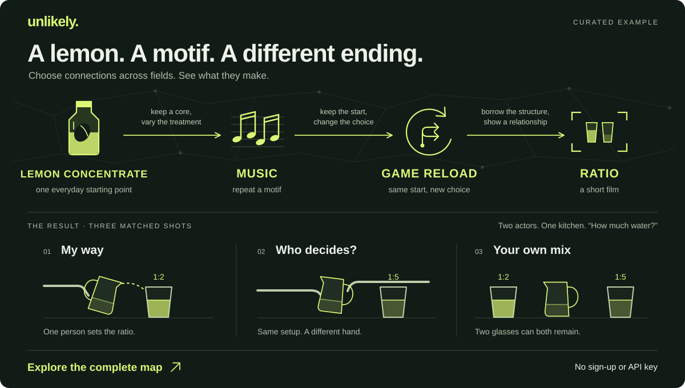

# Unlikely

**Lemon concentrate → music → game saves → a short film.**

Two siblings are clearing out their old kitchen. A bottle of lemon concentrate becomes the starting point for *Ratio*: three versions of the same question, and a different choice each time.

**[Explore the full map for *Ratio*](https://rre37826-source.github.io/unlikely/#example=writing)** · [简体中文](README.zh-CN.md) · [Run locally](#run-locally)



**Open the complete curated map immediately. No login, no API key, no model call.** This is an authored, interactive example; you can inspect the connections and choose your own route.

Examples open as previews and leave your saved map unchanged. Choose **Keep this map** to save the example and your changes on this device.

## How the connection becomes a scene

The task: a short film with **two actors and one kitchen**.

| Starting point | What the film borrows |
| --- | --- |
| Lemon concentrate: a reusable base, mixed in different proportions | Keep the same scene and question as the material for several variations. |
| Music: a recurring motif, rests, and call-and-response | Repeat “How much water?” in the same framing; let the answer, silence, and pouring change its meaning. |
| Games: reload the same starting point and change one choice | Return to the setup and change who controls the jug. Borrow a structure for variation, without requiring a literal time loop. |

In *Ratio*, the jug begins in the commanding sibling’s hand, becomes something both reach for, then is placed in the middle of the table. The final image holds two glasses labeled **1:2** and **1:5**. The siblings keep their different versions.

Unlikely is an open-source workspace for exploring connections like these. It shows a whole network with reasons for its links. **You decide which connections belong in the idea.**

## Try the route, then change it

1. **Open the full map.** The writing example loads without waiting for a model.
2. **Inspect a connection.** Click a node or line to see what the relationship contributes to the task.
3. **Choose what stays.** Try a complete preset route, or keep, reorder, and remove ideas yourself. Export your route as Markdown, JSON, or an SVG card.

Missing relationships remain visible. Suggested bridges use existing connections and require your choice. The featured route has an authored outcome; other routes can be explored independently.

## Writing, products, and business

All three complete examples begin with **lemon concentrate**. Each includes a full map and two preset routes with authored outcomes.

| Task | A direction to explore |
| --- | --- |
| Write a short film with two actors and one kitchen | *Ratio*: a repeated question changes from control to shared choice. |
| Design a product for interrupted creative work | A Context Capsule preserves the intention and reason behind a decision. |
| Explore a low-cost café service | A twenty-minute mixing stop to test on two quiet afternoons. |

These examples are curated, not live-generated. Matching a preset route shows its authored result. Without a model service, other routes summarize selected nodes and existing relationships rather than generating a new proposal.

## Bring your own task

Describe a writing, product, business, or other creative task, with optional inspiration and constraints. The public trial accepts requests without an account or visitor API key.

Custom generation has limits: **three model operations per anonymous session and per IP address per UTC day**, shared by generation, expansion, and synthesis; the tighter allowance wins. Global usage, concurrency, and monthly budget limits also apply. **Curated examples do not consume this allowance.**

One real public generation flow has been verified with Kimi K2.6. Real expansion and synthesis remain unverified; see the [verification record](docs/verification-v0.3.2.md). When the service is unavailable or the allowance is exhausted, your existing work and curated examples remain accessible. See [public-trial limits and data handling](docs/public-trial.md).

## Advanced: bring your own model

Open the optional model settings and enter an API base URL, model name, and API key, then **Test and connect**.

- The provider must support OpenAI-compatible `/chat/completions`, bearer authentication, JSON-object output through `response_format`, and browser CORS requests.
- Testing makes a model request; testing and subsequent generation, expansion, or synthesis may incur charges on **your provider account**, including reasoning charges where applicable.
- Browser requests go directly to your chosen provider. If CORS blocks them, use the local server below.

Advanced BYOK integrations have mock-based tests. The public generation check above does not verify browser BYOK, other providers, or real expansion and synthesis. A successful connection test alone does not prove all operations work.

## Run locally

Requires **Node.js 22.9.0 or newer**. No dependencies to install for the local app.

```sh
git clone https://github.com/rre37826-source/unlikely.git
cd unlikely
npm start
```

Open **[http://127.0.0.1:4317](http://127.0.0.1:4317)**. For server-side model requests:

```sh
cp .env.example .env
```

Set `MODEL_BASE_URL`, `MODEL_API_KEY`, and `MODEL_NAME` in `.env`, then restart `npm start`. The server appends `/chat/completions` to the base URL. This avoids browser CORS restrictions; provider compatibility and your account's charges still apply.

This server binds to `127.0.0.1` for local use. Public trial requests use a separate gateway with D1 quota storage; the local server is not a public production proxy. GitHub Pages continues to host the frontend.

## Data and content

| Item | Where it goes |
| --- | --- |
| Task, graph, route, and draft | Saved projects use this browser's `localStorage` when available. Example previews require **Keep this map**; export JSON for a portable copy. |
| Public-trial content | Through the gateway to its fixed model provider. The gateway does not persist task or graph content. |
| Public-trial quota data | D1 accounting and request records use HMAC-derived quota identifiers; raw IP addresses are not stored there. |
| Optional browser model settings | Page memory only; key, endpoint, and model clear on refresh and are excluded from storage and exports. |
| Server model credentials | Remain on the server and are not sent to the browser. |

There are no application analytics or user accounts. Hosting and model providers may keep their own service logs. Browser storage does not sync across devices; clearing site data removes the saved exploration. Public-trial rate limiting is separate from product analytics.

Content is labeled **curated**, **model-generated**, or **imported**. Connections distinguish **association**, **analogy**, and **hypothesis**. These labels describe origin and role, not proof of accuracy or value.

## Build with it

Plain HTML, CSS, JavaScript, and Node's built-in local server and test runner. English and Simplified Chinese are included.

```sh
npm test
npm run check
```

- `public/app.mjs`: task entry, exploration, routes, persistence, and exports.
- `public/core.mjs` and `public/layout.mjs`: graph validation, route logic, and layout for 1–16 clusters and up to 150 nodes.
- `public/model-client.mjs` and `public/model-protocol.mjs`: model requests and shared operation rules.
- `public/examples.mjs`: bilingual cases and complete routes.
- `trial/index.mjs`: public gateway handler; D1 and operator configuration are required.
- `server.mjs`: local server and optional private model adapter.

Star Unlikely to bookmark the project. Help it grow by sharing a route across fields with reasons for its connections, or reporting where the experience was confusing. See [CONTRIBUTING.md](CONTRIBUTING.md).

[MIT](LICENSE) © 2026 Unlikely contributors.
