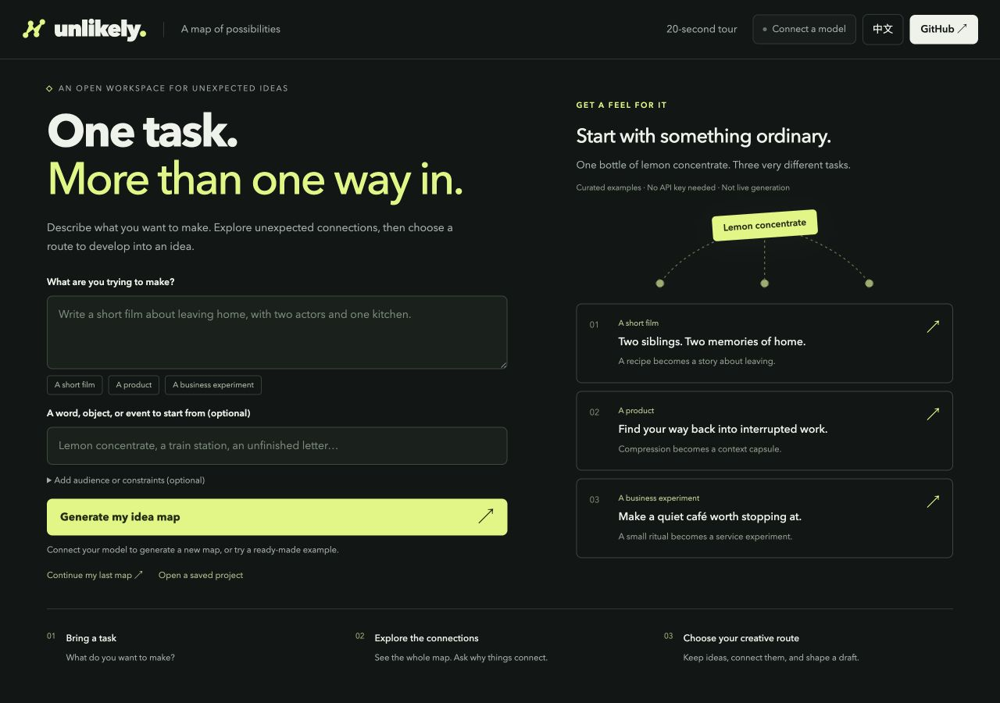
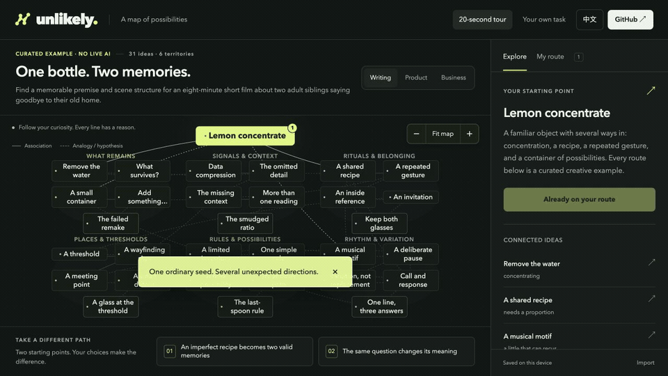

# Unlikely

**一个任务，不止一条思路。**

一个开源创意探索工具，适用于写作、产品、商业，以及你手头的具体任务。先说明想做什么，再探索意外的联系，由自己选出值得继续发展的创意主线。

**[打开 Unlikely](https://rre37826-source.github.io/unlikely/)** · [本地运行](#本地运行) · [English](README.md)



## 从任务到创意主线

1. **带着任务来。** 写下目标，选填已有灵感、受众和限制；也可以直接打开无需 API key 的精选案例。
2. **看见全景网络。** 点击节点和连线，查看联系的理由。接入模型后，可以深挖节点、寻找类比或反转前提。
3. **选出自己的主线。** 留下、重排或移除节点，整理成草案，或导出 Markdown、JSON 和 SVG 路线卡。

未建立的关系会明确显示。系统可以沿已有连线建议一条路径，由你决定是否加入。模型延展以追加方式加入新内容，保留已有网络和选定路线。



## 先试一个案例

三个精选案例都从**柠檬浓缩液**出发，每个包含六个分区、31 个节点和两条附完整结果的预设路线。

| 任务 | 可以继续发展的方向 |
| --- | --- |
| 写一部八分钟短片，只有两位演员和一间厨房 | 两个手足停止纠正对方调出的饮料，留下两种不同版本的家庭味道。 |
| 设计一个帮助创作者返回工作的产品 | 用“上下文胶囊”保留一个决定背后的意图和理由。 |
| 为社区咖啡店探索低成本服务 | 在两个清闲下午试办“二十分钟调味站”。 |

这些是**人工编排的案例，不是实时生成**。完整匹配预设路线时，会显示对应结果；未接入模型时，其他路线仅整理选中的节点和已有关系，不会生成新的 AI 方案。

## 在网页上接入自己的模型

在[网页](https://rre37826-source.github.io/unlikely/)中写下任务，点击**为我的任务生成联想网络**，或打开**连接模型**。填写服务商的 API 基础地址、模型名称和 API key，然后**测试并连接**。

- 服务需兼容 OpenAI `/chat/completions`、Bearer 认证和通过 `response_format` 请求 JSON 对象输出，并允许浏览器跨域请求（CORS）。
- **连接测试会发起一次模型请求，思考过程也可能计费。** 测试、生成、延展和整理主线都可能产生服务商费用，由你自己的账户承担。
- 浏览器直接请求你指定的服务商。如果服务商禁止浏览器直连，可以使用下方的本地服务器方式。

使用 Moonshot 官方接口时，请填写当前可用的型号，如 `kimi-k2.6` 或 `kimi-k3`。`kimi-k2.5` 已于 2026 年 8 月 31 日下线（[官方模型列表](https://platform.kimi.com/docs/models)）。连接测试会在发送请求前识别官方已下线型号，不会自动替换你选择的模型。报错会区分型号不可用、参数被拒绝、额度不足和输出截断，且不会显示服务商返回的原始消息。

**验证状态：** 网页与本地模型接口已进行 mock 测试，尚未使用真实服务商或模型验证。连接测试成功，也不代表该模型一定能生成合格网络或完成全部操作。

## 本地运行

需要 **Node.js 22.9.0 或更新版本**，无需安装依赖。

```sh
git clone https://github.com/rre37826-source/unlikely.git
cd unlikely
npm start
```

打开 **[http://127.0.0.1:4317](http://127.0.0.1:4317)**。如果希望通过本地服务器调用模型：

```sh
cp .env.example .env
```

在 `.env` 填写 `MODEL_BASE_URL`、`MODEL_API_KEY` 和 `MODEL_NAME`，然后重启 `npm start`。服务器会在基础地址后追加 `/chat/completions`。此方式绕开服务商的浏览器 CORS 限制，但仍需满足认证、模型兼容性和账户费用要求。

内置服务器仅监听 `127.0.0.1`，用于本机运行，不是公开部署的生产代理。GitHub Pages 托管网页，网页也可使用你自己的密钥直接调用模型服务。

## 数据与内容

| 内容 | 保存或发送位置 |
| --- | --- |
| 网页填写的 API key、基础地址、模型名称 | 仅保留在页面内存；刷新即清除，不写入浏览器存储，也不进入导出文件。 |
| 任务、网络、路线和草案 | 浏览器允许时保存在本机 `localStorage`；可导出 JSON 保留项目副本。 |
| 模型请求内容 | 由浏览器直接发送，或经本地服务器发送给你指定的服务商。 |
| 本地 `.env` 密钥 | 留在本地服务器，不会传到浏览器。 |

应用没有分析埋点和账号系统；托管平台及模型服务商可能保留各自的服务日志。本机浏览器保存不会跨设备同步，清除站点数据会删除已保存的探索。

内容区分**预设案例、模型生成和导入项目**；连线区分**关联、类比和假设**。这些标记说明来源和用途，不代表事实已经核实或创意已经有效。草案及候选应用仍需人的判断和验证。

## 开发与贡献

使用原生 HTML、CSS、JavaScript，以及 Node 内置服务器和测试工具，支持中英切换。

```sh
npm test
npm run check
```

- `public/app.mjs`：任务入口、网络探索、路线、本机保存和导出。
- `public/core.mjs`、`public/layout.mjs`：图校验、路线逻辑，以及支持 1–16 个分区、最多 150 个节点的布局。
- `public/model-client.mjs`、`public/model-protocol.mjs`：网页模型请求及生成、延展、整理主线的共享规则。
- `public/examples.mjs`：双语精选案例与完整路线。
- `server.mjs`：本地服务器与可选模型接口。

欢迎带来具体任务、意外但说得通的关系，或可以复现的问题。详见 [CONTRIBUTING.md](CONTRIBUTING.md)。如果想持续关注项目，也欢迎点一颗 star。

[MIT](LICENSE) © 2026 Unlikely contributors。
